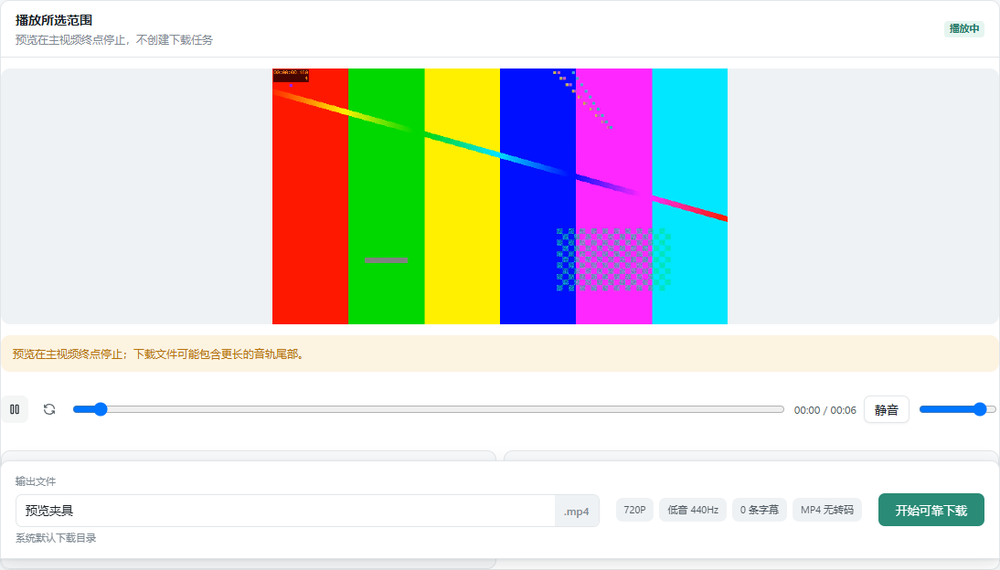
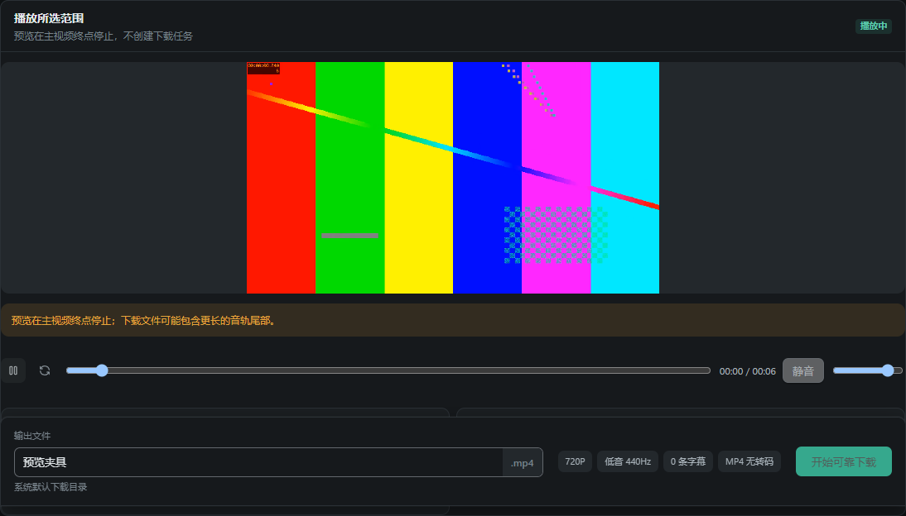

# HLS 所选范围预览：浏览器证据

对应 [Issue #14](https://github.com/rumoii/streamfirefly/issues/14)。预览按完整切片播放所选主视频范围及对应音轨；下载继续无转码合并，文件总时长及音轨尾音可能更长。

## 截图来源

- 源码：`feat/hls-selection-preview`，`207437bb9e51993bce8fbc1098702631c8a5ec48`；捕获时工作树干净，已合入上游 main `6e46775386d0c2248ca129e5baca09aded494e5c`。
- 构建：`npm run validate:extension` 生成的生产工作区和播放器组件，扩展版本 1.0.8。
- 页面：`http://127.0.0.1:65507/workspace.html`，测试脚本自己的本地 HTTP 服务；消息层和候选资源为夹具，没有网站、真实用户登录或 Native 后端。
- 媒体：ffmpeg 生成的两档 TS 视频和 440/880Hz 外置音轨。使用真实 Hls.js、网络加载、浏览器解码与原生 play；没有用 mock 代替播放。
- 浏览器：Edge 155.0.4283.45，Playwright headless，隔离 profile，1180×900 viewport。
- 状态：选择外置双音轨资源，手动开始预览，暂停后继续，等待“播放中”状态，再分别以浅色和深色主题截取播放器区域。底部可见的是实际固定下载栏。
- 捕获时间：2026-10-14 14:36:31（Asia/Shanghai）。两张图保留原始捕获内容，没有后期编辑；它们展示 UI 与媒体夹具，不证明网站覆盖或扩展鉴权。

浅色：

深色：

## 实际验证

| 检查 | 结果 |
| --- | --- |
| `npm run typecheck` | 通过 |
| `npm run validate:extension` | Chrome/Firefox 扩展构建及结构校验通过 |
| `npm run test:unit` | UI 276 项及后台、统计等聚合检查通过 |
| `node tools/test-hls-selection-preview.mjs --browser=chromium` | 35 执行通过、0 失败、0 跳过 |
| `node tools/test-hls-selection-preview.mjs --browser=firefox` | 34 执行通过、0 失败、1 跳过，覆盖不完整 |
| `git diff --check` | 通过 |

Firefox 使用 Playwright 配套 156.0。媒体矩阵覆盖真实 TS/fMP4、画质与音轨频谱、终点、暂停/重播/拖动、回收缓冲后重取片续播、无 AUDIO 分组音轨、AES、Range/206、MAP、discontinuity、请求中止及失败隔离。

Chromium 真实扩展鉴权另用 Chromium 153.0.8010.12 加载构建扩展：双 origin 服务验证候选同源 Authorization/Referer、跨源和重定向不注入候选 Authorization，以及 DNR apply/clear。它与消息层夹具的媒体测试分开执行。

没有验收标准安装版 Firefox 158、Firefox 真扩展网络栈或具体网站。真实扩展夹具未输入候选 Cookie；关 tab=0 是 clear=0 后的观测，不证明活跃规则关 tab 的完整真实清理。Firefox 对 Chromium 专属扩展路径的跳过不计入通过。

## 复跑

先构建扩展，准备与仓库 `playwright-core` 版本匹配的浏览器及 ffmpeg 夹具工具，再运行对应命令。`PLAYWRIGHT_BROWSERS_PATH` 指向匹配的浏览器缓存；需要复用其他已经安装的 Playwright runtime 时，可显式指定 `PLAYWRIGHT_MODULE`。`STREAMFIREFLY_PREVIEW_ARCHIVE` 指定独立、绝对的本地输出目录，保存媒体、结果和截图；Windows 上媒体浏览器默认是 Edge，可用 `EDGE_BINARY` 指定其他 Chromium 可执行文件。

本次截图是正式交付文档的一部分。临时媒体、profile、日志和任务报告保留在本地任务 archive，没有加入 Git。
